  

 

  
  &nbsp;
  
  &nbsp;
  
  &nbsp;
  

 

  
    
  <table align="center">
    <tr>
      <td align="center" width="150">💼 <b>Role</b></td>
      <td align="center" width="300">Full-Stack Developer</td>
    </tr>
    <tr>
      <td align="center">🎓 <b>Study</b></td>
      <td align="center">B.Tech CSE</td>
    </tr>
    <tr>
      <td align="center">📍 <b>Based</b></td>
      <td align="center">India 🇮🇳</td>
    </tr>
    <tr>
      <td align="center">🎯 <b>Focus</b></td>
      <td align="center">MERN, Next.js, TypeScript</td>
    </tr>
    <tr>
      <td align="center">🏆 <b>Won</b></td>
      <td align="center">IoT Competition, 2025</td>
    </tr>
    <tr>
      <td align="center">🚀 <b>Squad</b></td>
      <td align="center">Invertis Incubation</td>
    </tr>
    <tr>
      <td align="center">💼 <b>Work</b></td>
      <td align="center">Startups &amp; Freelance</td>
    </tr>
    <tr>
      <td align="center">📚 <b>Learning</b></td>
      <td align="center">System Design, DSA</td>
    </tr>
  </table>

 

  
    
  <table align="center">
    <tr>
      <td align="center" width="150">💻 <b>Languages</b></td>
      <td align="center"></td>
    </tr>
    <tr>
      <td align="center">🎨 <b>Frontend</b></td>
      <td align="center"></td>
    </tr>
    <tr>
      <td align="center">⚙️ <b>Backend</b></td>
      <td align="center"></td>
    </tr>
    <tr>
      <td align="center">🛠️ <b>Tools</b></td>
      <td align="center"></td>
    </tr>
  </table>

 

  
    
  <table align="center">
    <thead>
      <tr>
        <th align="center">Project</th>
        <th align="center">Type</th>
        <th align="center">Link</th>
      </tr>
    </thead>
    <tbody>
      <tr>
        <td align="center">🌿 <b>Formazen Nutrition</b></td>
        <td align="center">E-commerce, full-stack</td>
        <td align="center"><a href="https://www.formazen.in/"><b>Open ↗</b></a></td>
      </tr>
      <tr>
        <td align="center">📦 <b>AirDelivery</b></td>
        <td align="center">Startup product</td>
        <td align="center"><a href="https://www.airdelivery.in/"><b>Open ↗</b></a></td>
      </tr>
      <tr>
        <td align="center">🌐 <b>Aethravia</b></td>
        <td align="center">Startup website</td>
        <td align="center"><a href="https://www.aethravia.com/"><b>Open ↗</b></a></td>
      </tr>
      <tr>
        <td align="center">⚡ <b>Portfolio</b></td>
        <td align="center">Personal site</td>
        <td align="center"><a href="https://www.krishu.me/"><b>Open ↗</b></a></td>
      </tr>
    </tbody>
  </table>

 

  

 

  
    
  <a href="https://github.com/kkrishu">
    <picture>
      <source media="(prefers-color-scheme: dark)" srcset="https://streak-stats.demolab.com?user=kkrishu&hide_border=true&background=000000&ring=FFFFFF&fire=FFFFFF&currStreakNum=FFFFFF&sideNums=FFFFFF&currStreakLabel=FFFFFF&sideLabels=A3A3A3&dates=A3A3A3">
      
    </picture>
  </a>
  &nbsp;&nbsp;
  <a href="https://github.com/kkrishu">
    <picture>
      <source media="(prefers-color-scheme: dark)" srcset="https://github-readme-stats.vercel.app/api/top-langs/?username=kkrishu&layout=compact&langs_count=6&hide_border=true&bg_color=000000&title_color=FFFFFF&text_color=A3A3A3">
      
    </picture>
  </a>

 

  

